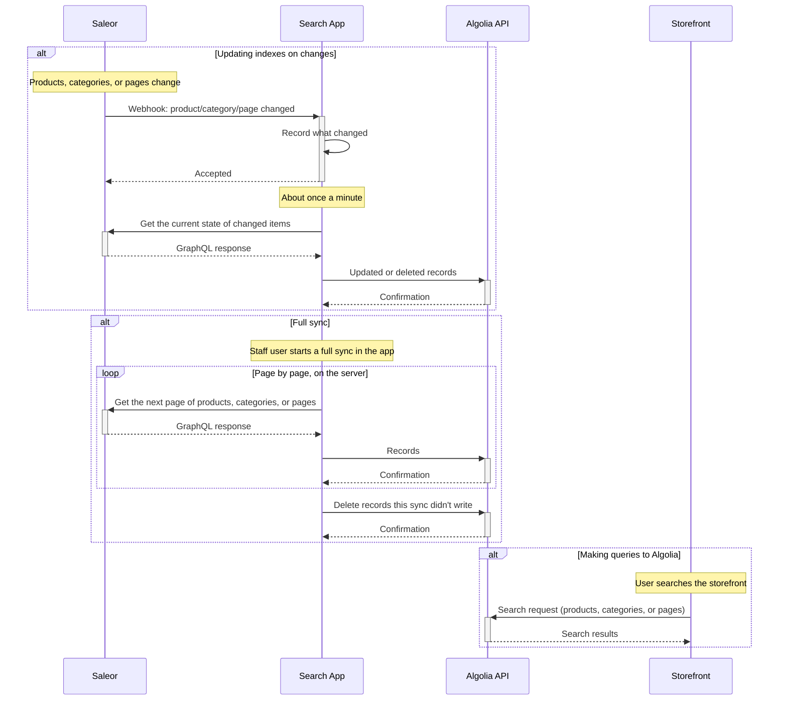

<Callout type="info">

Saleor version required: **3.22**. [Repository](https://github.com/saleor/apps/tree/main/apps/search).

</Callout>

The application provides integration with [Algolia](https://www.algolia.com/) search engine. It keeps your products, categories, and pages in Algolia indexes, so your storefront can search them using Algolia's API.

## Features

- Synchronize products, categories, and pages with Algolia
- Send changes to Algolia on their own, usually within a minute of the change in Saleor
- Run full syncs on the server: you can close the app while they run
- Remove records of deleted or hidden products, categories, and pages when a full sync finishes
- See the state of syncing in the app: progress of a running full sync, the result of the last one, changes waiting to be sent, and when changes last reached Algolia
- Selective page indexing: choose which page types to sync
- Choose which optional fields each record carries, to stay within Algolia's record size limit

## Assumptions & limitations

- Records that already exist in Algolia are created by a full sync. Run one for products (and for categories and pages, if you search them) after you connect the app, and again after you change which fields are sent. Changes made in Saleor after that reach Algolia on their own.
- The application creates a separate record for each product variant
- A single record size is limited due to [Algolia record size constraint](https://www.algolia.com/doc/guides/sending-and-managing-data/prepare-your-data/how-to/reducing-object-size/). That means the data attached to your records, such as the number of attributes, can exceed that limit. In that case, the app skips the record and reports an app problem in the Dashboard that names the product variant, category, or page. See [Record size limit exceeded](#record-size-limit-exceeded).
- Each of the channels is indexed separately
- At this moment translations are not supported
- The exact state of the product quantity is not indexed, only the boolean value (in stock / out of stock)
- Page indexing is selective: you choose which page types to sync. With no page type selected, pages aren't indexed.
- The app does not apply index settings (grouping, searchable attributes, faceting) on its own. Apply them once with **Apply recommended settings** in the app. Applying them overwrites the same settings if you changed them in Algolia.
- The app will synchronize data on the following [events](/developer/extending/webhooks/asynchronous-events):
  - `PRODUCT_CREATED`
  - `PRODUCT_UPDATED`
  - `PRODUCT_DELETED`
  - `PRODUCT_VARIANT_CREATED`
  - `PRODUCT_VARIANT_UPDATED`
  - `PRODUCT_VARIANT_DELETED`
  - `PRODUCT_VARIANT_OUT_OF_STOCK`
  - `PRODUCT_VARIANT_BACK_IN_STOCK`
  - `PRODUCT_VARIANT_DISCOUNTED_PRICE_UPDATED` (a feature preview event: it keeps discounted prices current when a promotion starts or ends)
  - `CATEGORY_CREATED`
  - `CATEGORY_UPDATED`
  - `CATEGORY_DELETED`
  - `PAGE_CREATED`
  - `PAGE_UPDATED`
  - `PAGE_DELETED`

## Glossary

- Algolia record: single entry in the Algolia index. Each product variant, category, and page is a separate record.
- Index: a collection of Algolia records. Separate indices are created for products, categories, and pages within each channel. Each products channel creates separate index, but pages and categories have their own single indices.

## Permissions required by the app

- `MANAGE_PRODUCTS`
- `MANAGE_PRODUCT_TYPES_AND_ATTRIBUTES`
- `MANAGE_PAGES`

## Application flow

Webhooks only tell the app what changed. The app then reads the current state from Saleor and writes it to Algolia. Changes to the same product that arrive close together are sent once.



While a full sync runs, changes made in Saleor wait and are sent after it finishes, so they always land last.

## Pre-requisites

- [Algolia](https://www.algolia.com/) account. The free account will be sufficient, but has additional limitations, like maximum record size.
- Saleor user with `MANAGE_APPS`, `MANAGE_PRODUCTS`, `MANAGE_PRODUCT_TYPES_AND_ATTRIBUTES` and `MANAGE_PAGES` permissions.

If you have installed the app before indexing pages and categories have been introduced, you need to reinstall the app to grant new permissions

## Configuration

All settings are on one page in the app. Settings in every section apply to the whole store, not to a single channel. A section menu on the left takes you to each section, and the bar at the bottom saves all changes at once and lists the sections you changed.

### Connect Algolia

1. In the Algolia dashboard, go to [API Keys](https://dashboard.algolia.com/account/api-keys/all). Copy the **Application ID** and an API key that can write records: it needs the `addObject`, `deleteObject`, `browse`, `listIndexes`, and `editSettings` permissions. The Admin API Key has them. Don't use the Search-Only API Key.
2. In the Search App, fill in the **Algolia connection** section:
   - **Application ID**
   - **Write API Key**
   - **Index name prefix** (optional). Recommended if you use the same Algolia application for several Saleor instances, for example `staging` and `production`.
3. Click **Save**. The app checks the keys with Algolia before saving them, and turns on its webhooks.

After the keys are saved, the app doesn't show them again: the key field shows only the last four characters of the saved key. To replace the key, type a new one and save. To keep it, leave the field empty. **Test connection** checks whether Algolia still accepts the saved keys.

Until the first full product sync finishes, a setup checklist at the top of the page shows what is left to do.

### Run the first full sync

In the **Sync** section, click **Full sync** next to **Products**. Do the same for **Categories** and **Pages** if your storefront searches them. Full syncs run on the server, so you can close the app. Each row shows:

- **Queued** until the sync starts, then **Syncing** with the number of products, categories, or pages written so far
- When the last full sync finished and how many items it wrote, or that it failed

When a full sync finishes, it deletes records the sync didn't write: products, categories, and pages that were deleted or hidden in Saleor, and records left from before. A full sync that fails 5 times in a row stops and reports an app problem. Changes made in Saleor still sync in the meantime. Start it again once the cause is fixed.

Below the rows, **Waiting changes** shows how many changed items wait to be sent (above 1,000 it shows "1,000+"), and **Last update sent** shows when changes last reached Algolia.

### Apply recommended index settings

In the **Index settings** section, click **Apply recommended settings**. This sets up the product indexes to:

- Group variants of one product into a single result (distinct on `productId`). See [Grouping results](#grouping-results).
- Search name, description, category, and collections
- Filter by category, collection, price, product type, stock, and attributes

Applying them overwrites the same settings if you changed them in Algolia.

The application is now configured and synchronized. You can start making queries using the Algolia API or browse the data in the Algolia dashboard.

### Fields configuration

Algolia limits the size of a single record, so not all data fits. In the **Product records** section, choose which optional fields each product variant record carries. The section shows how many of them are sent. Name, SKU, prices, stock, availability, and thumbnail are always sent.

By default, all optional fields are enabled. Turn off fields your storefront doesn't search or filter by, for example product metadata or descriptions.

Records already in Algolia keep their old fields until a full sync rewrites them. After you save a change that affects records (fields, page types, the Algolia application, or the index prefix), the bar at the bottom suggests the full syncs that update existing records. The app doesn't start them on its own: click **Run full sync**, or **Not now** to run them later from the **Sync** section.

### Page type selection

Not every page belongs in search results. In the **Pages** section, select which **page types** to index. Only pages of the selected types are synced to Algolia. With no type selected, pages aren't indexed.

To keep page records lean, you can turn off the `attributes`, `metadata`, `seoDescription`, or `contentPlaintext` fields for all page records under **Page fields** in the same section.

Indexing pages requires the `MANAGE_PAGES` permission. If you installed the app before page indexing was introduced, reinstall the app to grant it.

## Data model

### Indices

Each channel creates separate indices for products, categories, and pages. The index names are formatted as follows:

- **Products**: `OPTIONAL_PREFIX.CHANNEL_SLUG.CURRENCY_CODE.products` — e.g. `dev.default-channel.USD.products`
- **Categories**: `OPTIONAL_PREFIX.categories` — e.g. `dev.categories`
- **Pages**: `OPTIONAL_PREFIX.pages` — e.g. `dev.pages`

The `OPTIONAL_PREFIX` is used to distinguish between different Saleor instances, so you can use the same Algolia account for multiple data sources (e.g. staging and production).
Values for the price and availability in the product index are chosen according to the chosen channel.

### Product record fields

- `objectID`: Unique ID of the record, used by Algolia. It's a concatenation of the `productId` and `variantId` fields, separated by `_`
- `productId`: Product ID
- `variantId`: Product Variant ID
- `productTypeId`: Product Type ID. The field is used for faceting
- `categoryId`: Category ID. The field is used for faceting
- `categorySlug`: Category slug. The field is used for search and faceting
- `name`: Joined product and variant name (format: `Product Name - Variant Name`). The field is used for the search
- `productName`: Product name. The field is used for the search
- `variantName`: Variant name. The field is used for the search
- `sku`: Variant SKU
- `attributes`: List of product and variant attributes with their values. The field is used for search and faceting
- `media`: List of product media
  - `url`: URL of the media file
  - `type`: Type of the media file. Possible values: `IMAGE`, `VIDEO`
- `description`: Product description in the EditorJS format
- `descriptionPlaintext`: Product description in the plaintext. The field is used for the search
- `slug`: Product slug
- `thumbnail`: URL for the Product thumbnail
- `grossPrice`: Base price of the product in the channel's currency. The field is used for faceting
- `pricing`: Detailed pricing object with the following nested fields, all used for faceting:
  - `pricing.price.net`, `pricing.price.gross`: Current price
  - `pricing.discount.net`, `pricing.discount.gross`: Discount amount
  - `pricing.priceUndiscounted.net`, `pricing.priceUndiscounted.gross`: Price before discount
  - `pricing.onSale`: Boolean indicating if the variant is on sale
- `inStock`: Boolean value indicating if the product is in stock. The field is used for faceting
- `categories`: Hierarchical list of product categories, formatted according to the [Algolia guidelines](https://www.algolia.com/doc/guides/managing-results/refine-results/faceting/#hierarchical-facets). The field is used for faceting
- `collections`: List of collection names the product belongs to. The field is used for faceting
- `metadata`: Key-value pairs of product metadata
- `variantMetadata`: Key-value pairs of variant metadata
- `otherVariants`: List of other variant IDs of the product

### Category record fields

Categories are stored in a dedicated index with the following fields:

- `objectID`: Category ID, used by Algolia
- `name`: Category name. The field is used for search
- `slug`: Category slug. The field is used for search
- `level`: Depth in the category tree. The field is used for faceting
- `ancestors`: Flat array of parent categories, each containing `id`, `name`, and `slug` — useful for breadcrumb rendering. The field is used for search and faceting
- `metadata`: Key-value pairs of category metadata. The field is used for faceting
- `_type`: Always `"category"`. Useful for distinguishing record types in unified search results

### Page records

Pages are stored in a dedicated index. You choose which **page types** to sync in the **Pages** section. Only pages of the selected types are indexed.

To keep records within the Algolia size limit, you can turn off the `attributes`, `metadata`, `seoDescription`, or `contentPlaintext` fields for all page records under **Page fields**. The exact set of indexed fields depends on your configuration.

Every page record includes a `_type` field set to `"page"` and a `pageTypeId` field (used for faceting), so you can distinguish page results and filter by page type in your storefront.

## Making queries

The Search App is responsible only for indexing the data. To make queries you need to use the Algolia API directly. You can use the [Algolia JavaScript client](https://www.algolia.com/doc/api-client/getting-started/install/javascript/?client=javascript). The example below shows how to make a simple search query using it:

```javascript
const algoliasearch = require("algoliasearch");

// Replace with your own values
const APP_ID = "APP_ID";
const API_KEY = "API_KEY";
const INDEX_NAME = "dev.default-channel.USD.products";

// Initialize the client
const client = algoliasearch(APP_ID, API_KEY);
const index = client.initIndex(INDEX_NAME);

// Example search query
index.search("squeezed juice").then(({ hits }) => {
  console.log(hits);
});
```

Running the example above will return the following results:

```json
[
  {
    "objectID": "UHJvZHVjdDoxNTU=_UHJvZHVjdFZhcmlhbnQ6Mzg3",
    "productId": "UHJvZHVjdDoxNTU=",
    "variantId": "UHJvZHVjdFZhcmlhbnQ6Mzg3",
    "productTypeId": "UHJvZHVjdFR5cGU6OQ==",
    "categoryId": "Q2F0ZWdvcnk6MTQ=",
    "categorySlug": "juices",
    "name": "Carrot Juice - UHJvZHVjdFZhcmlhbnQ6Mzg3",
    "productName": "Carrot Juice",
    "variantName": "UHJvZHVjdFZhcmlhbnQ6Mzg3",
    "sku": "CJ-001",
    "attributes": {
      "Flavor": "Carrot"
    },
    "media": [
      {
        "url": "https://example.saleor.cloud/media/thumbnails/products/saleor-carrot-drink_thumbnail_4096.png",
        "type": "IMAGE"
      }
    ],
    "description": {
      "time": 1652790989820,
      "blocks": [
        {
          "id": "VWVrSI_Cza",
          "data": {
            "text": "Improve your eyesight the natural way with <b>100% pure, squeezed carrot juice</b>. The sweet, orange nectar of <i>Mother Earth</i>."
          },
          "type": "paragraph"
        }
      ],
      "version": "2.22.2"
    },
    "descriptionPlaintext": "Improve your eyesight the natural way with 100% pure, squeezed carrot juice. The sweet, orange nectar of Mother Earth.",
    "slug": "carrot-juice",
    "thumbnail": "https://example.saleor.cloud/media/thumbnails/products/saleor-carrot-drink_thumbnail_256.png",
    "grossPrice": 1.99,
    "pricing": {
      "price": { "net": 1.99, "gross": 2.45 },
      "discount": { "net": 0, "gross": 0 },
      "priceUndiscounted": { "net": 1.99, "gross": 2.45 },
      "onSale": false
    },
    "inStock": true,
    "categories": {
      "lvl0": "Groceries",
      "lvl1": "Groceries > Juices"
    },
    "collections": [],
    "metadata": {},
    "variantMetadata": {},
    "otherVariants": [],

    "_highlightResult": {
      "name": {
        "value": "Carrot <em>Juice</em> - UHJvZHVjdFZhcmlhbnQ6Mzg3",
        "matchLevel": "partial",
        "fullyHighlighted": false,
        "matchedWords": ["juice"]
      },
      "productName": {
        "value": "Carrot <em>Juice</em>",
        "matchLevel": "partial",
        "fullyHighlighted": false,
        "matchedWords": ["juice"]
      },
      "variantName": {
        "value": "UHJvZHVjdFZhcmlhbnQ6Mzg3",
        "matchLevel": "none",
        "matchedWords": []
      },
      "descriptionPlaintext": {
        "value": "Improve your eyesight the natural way with 100% pure, <em>squeezed</em> carrot <em>juice</em>. The sweet, orange nectar of Mother Earth.",
        "matchLevel": "full",
        "fullyHighlighted": false,
        "matchedWords": ["squeezed", "juice"]
      }
    }
  }
]
```

### Grouping results

Since each variant is a separate record in the Algolia index, our recommended settings apply grouping to the results. This means that the results are grouped by the Product ID, and the variant with the highest score is returned as the main result.

Read more about grouping in the [Algolia recordation](https://www.algolia.com/doc/guides/managing-results/refine-results/grouping).

### Custom faceting

The application pre-configures faceting settings for indexes. You can modify their visibility and other settings in the Algolia dashboard. Read more about faceting in the [Algolia recordation](https://www.algolia.com/doc/guides/managing-results/refine-results/faceting/).

Examples of building interfaces with faceting can be found in the [Inspiration Library](https://www.algolia.com/search-inspiration-library/).

## Troubleshooting

### Record size limit exceeded

If the app can't store a record because it's too large, it skips that record and reports an app problem in the Saleor Dashboard, for example:

```
Product variant UHJvZHVjdFZhcmlhbnQ6MTIz exceeds Algolia's record size limit.
```

**Cause**: Algolia enforces a maximum record size of 10KB (or more depending on your plan). Products with large descriptions, many attributes, or extensive metadata can exceed this limit. Pages with heavy content blocks can also hit this limit.

**Solution**: In the Search App, turn off fields you don't need in the **Product records** section:

- `description` / `descriptionPlaintext` - often the largest fields, especially for products with rich HTML content
- `metadata` / `variantMetadata` - can contain large amounts of custom data
- `media` - if you don't need media URLs in search results

For pages, turn off the `attributes`, `metadata`, `seoDescription`, or `contentPlaintext` fields under **Page fields** in the **Pages** section.

Then run a full sync so the skipped records are written with the smaller field set.

**Alternative**: If you still need a searchable description, create a shorter product attribute (e.g., `algoliaDescription`) with a condensed version of your description. Product attributes are automatically synced to Algolia and can be used for search.

### Live updates are off

If the **Sync** section shows **Live updates off**, Saleor has turned off the app's webhooks, usually after repeated delivery failures, for example after the Algolia key was revoked. Changes in Saleor don't reach Algolia until the webhooks are back on.

Fix the cause first: if the key changed, save the new one in the **Algolia connection** section, which also turns the webhooks back on. Otherwise click **Turn back on**. Then run a full sync to catch up on changes made while the webhooks were off.

### Invalid Algolia credentials

If Algolia rejects the saved keys, or the Application ID doesn't exist, the app reports an app problem and is deactivated. Changes it had already recorded are kept and sent once it works again. Save valid keys in the **Algolia connection** section, activate the app again in the Dashboard, and run a full sync to catch up on changes made while it was deactivated. **Test connection** shows whether Algolia accepts the saved keys.

### A full sync failed

If a full sync fails 5 times in a row, for example because Algolia is unreachable or the plan's limits are exceeded, it stops and the app reports an app problem. Some items may be missing or outdated in search, but changes made in Saleor still sync. Check that Algolia is reachable and its limits aren't exceeded, then start the full sync again in the **Sync** section. The problem clears when that sync finishes.

## Development

To run the application locally, follow the [_Running Saleor Apps locally_ article](/developer/extending/apps/developing-apps/running-saleor-apps-locally).
