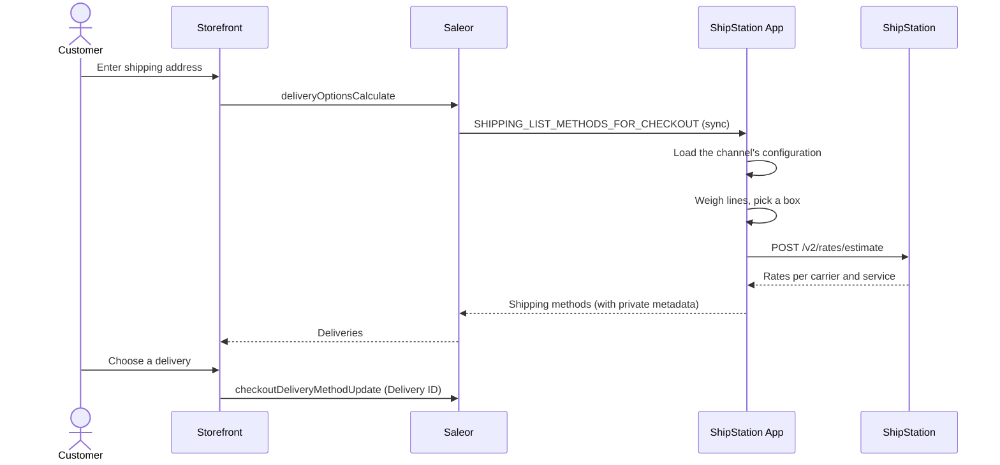
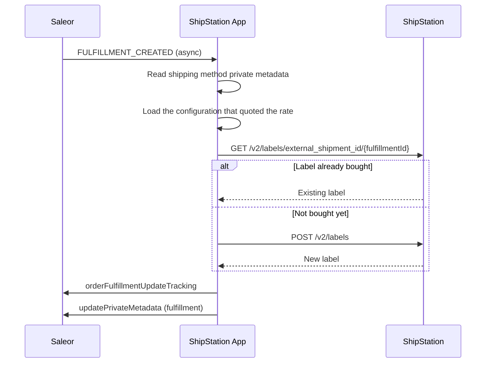

This page describes how the ShipStation App works: which Saleor events it handles, what it sends to ShipStation, and how it decides the weight and box of a shipment.

## Permissions

The app requests these permissions at installation:

| Permission        | Why                                                                                                    |
| ----------------- | ------------------------------------------------------------------------------------------------------ |
| `MANAGE_SHIPPING` | Reading the private metadata of the order's shipping method, which tells the app which carrier to buy. |
| `MANAGE_ORDERS`   | Writing the tracking number and label metadata to fulfillments, and adding order notes.                |

The app does not request `MANAGE_PRODUCTS`. As a result, it sees only product attributes that are visible in the storefront.

To open the app's configuration page and the Playground, a staff user needs the `MANAGE_SHIPPING` and `MANAGE_APPS` permissions. To see and manage labels on the order page, a staff user needs the `MANAGE_ORDERS` permission. See [Order page labels](./order-labels).

## Dashboard Extensions

| Mount                        | Target   | What it shows                                                                                        |
| ---------------------------- | -------- | ---------------------------------------------------------------------------------------------------- |
| `ORDER_DETAILS_WIDGETS`      | `WIDGET` | The order's live ShipStation labels, with tracking and cost, and an **Open shipping labels** button. |
| `ORDER_DETAILS_MORE_ACTIONS` | `POPUP`  | **ShipStation labels**: the full labels view, opened from the order's menu or from the widget.       |

Both require `MANAGE_ORDERS`.

## Webhooks

| Event                                | Type  | What the app does                                                                 |
| ------------------------------------ | ----- | --------------------------------------------------------------------------------- |
| `SHIPPING_LIST_METHODS_FOR_CHECKOUT` | Sync  | Quotes ShipStation rates for the checkout and returns them as shipping methods.   |
| `FULFILLMENT_CREATED`                | Async | Buys a label for the fulfillment and writes the tracking number back.             |
| `FULFILLMENT_CANCELED`               | Async | Voids the fulfillment's label.                                                    |
| `ORDER_CANCELLED`                    | Async | Voids the labels of every fulfillment of the order that is not already cancelled. |

:::note
Saleor stores subscription queries when the app is installed. When a new app version changes a subscription query, reinstall the app to get the new payload.
:::

## Rates at checkout

The storefront asks for shipping methods with [`deliveryOptionsCalculate`](/api-reference/shipping/mutations/delivery-options-calculate), which triggers `SHIPPING_LIST_METHODS_FOR_CHECKOUT`. It then passes the `id` of the chosen `deliveries` entry as `deliveryMethodId` to `checkoutDeliveryMethodUpdate`. See the [checkout API guide](/developer/checkout/api-guide#shipping-methods).

When Saleor asks for shipping methods, the app:

1. Finds the configuration assigned to the checkout's channel. If the channel has none, the app returns an empty list. This is not an error.
2. Requires a shipping address on the checkout. Without one, the app answers with an error and Saleor shows no methods from the app.
3. [Weighs each line](#how-the-app-weighs-a-shipment). If no line gets a weight, the app returns no methods and reports the missing-weight problem.
4. [Picks a box](#how-the-app-picks-a-box).
5. Requests a rate estimate from ShipStation for every carrier in the configuration, in one request. The request includes the ship-from address of the configuration, the destination country, postal code, city and state, the total weight in grams, and the box dimensions.
6. Converts each quote into a Saleor shipping method.

### How quotes become shipping methods

| Shipping method field           | Value                                                                                                                        |
| ------------------------------- | ---------------------------------------------------------------------------------------------------------------------------- |
| `id`                            | `<carrier_id>:<service_code>`. Saleor wraps it into its own app shipping method ID.                                          |
| `name`                          | ShipStation's `service_type`, for example `USPS Priority Mail`.                                                              |
| `amount`                        | Shipping amount plus the insurance, confirmation and other amounts, when ShipStation returns them.                           |
| `currency`                      | ShipStation's currency, upper-cased.                                                                                         |
| `minimum/maximum_delivery_days` | The carrier's range (for example `2-5`), or ShipStation's `delivery_days` for both. Left out when neither is a whole number. |
| `private_metadata`              | `shipstation.carrierId`, `shipstation.serviceCode` and `shipstation.configId`.                                               |

The app drops some quotes:

- Quotes for packaging other than the generic `package` (flat-rate envelopes and similar). The label is always bought as `package`, so those prices could not be honored.
- Entries that carry no usable quote. ShipStation returns these for a carrier that can't serve the address or the service. The app logs the carrier's error messages and keeps the other quotes.

Saleor itself drops methods whose currency differs from the checkout currency.

### Errors during rates

Any error while quoting returns no methods from the app. The checkout still shows built-in shipping methods and methods from other apps. ShipStation refusing the request (for example, a bad address or a rejected key) is logged as a warning. ShipStation being unreachable is logged as an error. A rejected API key is also reported as an [app problem](./problems).

Saleor waits up to 20 seconds for the app's answer (2 seconds to connect, 18 seconds to respond).

## How the app weighs a shipment

ShipStation always receives the weight in grams. The app converts each line to grams first and then adds them up, so lines may use different units.

A line's weight is the first positive value from these steps:

1. The configuration's **weight attribute** on the variant (optional). This is a numeric attribute with a weight unit of the configuration's unit system (metric: `G`, `KG`, `TONNE`; imperial: `LB`, `OZ`).
2. The same attribute on the product.
3. **Saleor's weight** on the variant, then the product, then the product type. Any Saleor weight unit works here.
4. The configuration's **default item weight** (optional), entered in grams (metric) or ounces (imperial). It is used only for lines that need shipping.

The total weight is the sum of each line's weight multiplied by its quantity.

A weight attribute with no unit, or with a unit of the other system, is skipped with a warning in the logs, and the line moves on to step 3. This can happen when the attribute's unit is changed in Saleor after you selected it in the configuration.

Lines that don't need shipping are never weighed. At checkout, this comes from the product type's **Is shipping required** setting. At fulfillment, it comes from the order line.

When no step gives a line a weight:

- **At checkout**, the line is left out of the quote. The checkout still gets rates as long as at least one line has a weight. When no line has a weight, the checkout gets no ShipStation methods and the app reports the missing-weight problem.
- **At fulfillment**, the label is refused rather than bought underweight. The order note lists the weight steps, and the label purchase problem is reported.

## How the app picks a box

Saleor has no built-in product dimensions. The app reads them from three numeric attributes that you select in the configuration: length, width and height.

Each configuration has a unit system, metric or imperial. Boxes and default item dimensions are entered in centimeters (metric) or inches (imperial). Attribute values are converted from the attribute's own unit. Conversions never cross between metric and imperial:

| Unit system | Accepted length units of attributes | Boxes and defaults in | Sent to ShipStation as |
| ----------- | ----------------------------------- | --------------------- | ---------------------- |
| Metric      | `MM`, `CM`, `DM`, `M`, `KM`         | cm                    | `centimeter`           |
| Imperial    | `INCH`, `FT`, `YD`                  | inch                  | `inch`                 |

For every line that has a weight:

1. **Item size.** The app reads each side from the variant's attribute, falling back to the product's attribute. If any of the three sides is missing, the whole item uses the default item dimensions. A side whose attribute has no unit, or a unit of the other system, counts as missing.
2. **Totals.** The app adds up item volume multiplied by quantity, and tracks the longest side of any single item.
3. **Box.** The app picks the smallest box (by volume) whose volume holds the total and whose longest side is at least the longest item side. Checking the side stops a long, thin item from being placed in a small cube.
4. **Fallback.** If no box fits, the app uses the largest box and reports the no-box-fits problem. A quote with a box that is too small is better than no quote. The carrier adjusts the charge later, and ShipStation shows the adjustment.

Lines without a weight (digital goods, or no weight from any step) are left out of packing as well.

:::warning
The app treats items as a fluid volume, limited only by the longest side. It does not do 3D packing, so it can pick a box that can't physically hold the items in any arrangement.
:::

## Label purchase

When a fulfillment is created, the app goes through these checks in order:

| Check                                                          | Result when it fails                                                                             |
| -------------------------------------------------------------- | ------------------------------------------------------------------------------------------------ |
| The payload has an order, a fulfillment and a shipping address | The webhook answers with an error. No label.                                                     |
| The order's shipping method carries the app's private metadata | Skipped. No label, no note. The order is shipped some other way.                                 |
| The configuration that quoted the rate still exists            | No label. An order note and the configuration-missing problem.                                   |
| The shipping address has a phone number                        | No label. An order note and the missing-phone problem.                                           |
| At least one line of the fulfillment needs shipping            | No label. An order note says there is nothing to ship.                                           |
| Every line that needs shipping has a weight                    | No label. An order note lists the weight steps, and the label purchase problem is reported.      |
| ShipStation accepts the label request                          | No label. An order note quotes ShipStation's answer, and the label purchase problem is reported. |

### Which shipping methods belong to the app

A store can ship some orders through this app, and others through built-in Saleor methods, another shipping app or click and collect. Saleor sends `FULFILLMENT_CREATED` for all of them.

The app treats an order as its own only when the order's shipping method carries both `shipstation.carrierId` and `shipstation.serviceCode` in its private metadata. Saleor copies this metadata from the method to the order when the checkout is completed. The app never parses the Saleor shipping method ID.

This has two consequences:

- An order whose shipping method was changed after checkout, for example to a built-in method, carries no ShipStation metadata and is skipped.
- Only checkout completion stores the metadata. Draft orders can't use app shipping methods at all.

### Which configuration buys the label

The label is bought with the configuration whose ID is stored on the shipping method (`shipstation.configId`), not with the configuration the channel uses today. Carrier IDs belong to one ShipStation account, so only the configuration that quoted the rate can buy it.

This means:

- Assigning another configuration to the channel affects only new checkouts.
- Editing a configuration (ship-from address, boxes, weight settings, label format) affects labels of orders that were already placed, because the label is built from the configuration's current settings.
- Replacing a configuration's API key with a key of another ShipStation account breaks labels for open orders, because their carrier IDs belong to the old account.
- Deleting a configuration means its open orders can't get labels from Saleor. Buy them in ShipStation directly.

### What the label request contains

| Field                  | Value                                                                                                                                   |
| ---------------------- | --------------------------------------------------------------------------------------------------------------------------------------- |
| Carrier and service    | From the shipping method's private metadata.                                                                                            |
| `external_shipment_id` | The Saleor fulfillment ID.                                                                                                              |
| Order reference        | The order number as `shipment_number`, the order ID as `external_order_id`, and `Order #<number>` printed on the label as `reference1`. |
| Ship date              | The time the webhook is handled.                                                                                                        |
| Ship from              | The configuration's ship-from address, marked as not residential.                                                                       |
| Ship to                | The order's shipping address with its phone number. Residential indicator `unknown`.                                                    |
| Package                | One `package` with the total weight of this fulfillment's lines and the dimensions of the chosen box.                                   |
| Address validation     | Off (`no_validation`).                                                                                                                  |
| Label format           | The configuration's format: PDF, PNG or ZPL. Download type `url`.                                                                       |

With partial fulfillments, each fulfillment gets its own label, weighed and packed from its own lines only.

The order reference lets you find the Saleor order from a label in ShipStation. Carriers cut the printed reference at 25 to 60 characters, depending on the carrier.

### Preventing duplicate labels

Buying a label costs money and ShipStation API v2 has no idempotency key. To stop a redelivered webhook from buying a second label, the app sends the Saleor fulfillment ID as `external_shipment_id` and looks it up before every purchase:

- If ShipStation has a label for that ID, the app reuses it and buys nothing.
- If not, the app buys a new label.

The webhook buys at most one label per fulfillment. A fulfillment can still hold more labels, bought by staff from the [order page](./order-labels). They carry the same `external_shipment_id`, so the webhook's lookup finds them too, and the cancel webhooks void all of them.

Because of this lookup, the app can safely answer with an error when writing back to Saleor fails, and let Saleor retry the webhook.

:::warning
The check and the purchase are two separate requests. Two deliveries of the same event that arrive at exactly the same time could both buy a label. Saleor does not deliver the same event that way in normal operation.
:::

### What the app writes to Saleor

After the label is bought, the app:

1. Sets the fulfillment's tracking number with `orderFulfillmentUpdateTracking` and `notifyCustomer: false`.
2. Writes these keys to the fulfillment's **private** metadata:

| Key                       | Value                                                                                                   |
| ------------------------- | ------------------------------------------------------------------------------------------------------- |
| `shipstation.labelId`     | The ID of the fulfillment label: the label its tracking number belongs to.                              |
| `shipstation.configId`    | The configuration that bought the label. Its API key is used to find and void the fulfillment's labels. |
| `shipstation.labelUrl`    | The label download URL in the configured format. Left out if ShipStation returns none.                  |
| `shipstation.trackingUrl` | The carrier's public tracking page. Left out for carriers that don't provide one.                       |

The label is stored in private metadata, not public metadata, because it shows the customer's full address. Public metadata can be read from the storefront. If you want to show the tracking page to customers, copy the URL to a place your storefront can read.

If either write fails, the webhook answers with an error and Saleor retries it. The retry reuses the label already bought.

### Failed purchases are not retried

When ShipStation refuses a label, the webhook still answers successfully, so Saleor does not retry it. A refused label stays refused until something changes, for example carrier funds, the carrier setup in ShipStation, or the order's address. After fixing the cause, buy the label from the [order page](./order-labels), or cancel the fulfillment and fulfill again.

## Voiding labels

`FULFILLMENT_CANCELED` voids the labels of the cancelled fulfillment. Cancelling an order in Saleor does not cancel its fulfillments, so `ORDER_CANCELLED` voids the labels of every fulfillment of the order that is not already cancelled.

The app voids every label of the fulfillment that is not voided yet: the one bought by the webhook and any bought by staff from the order page. For each fulfillment, the app:

1. Finds the configuration that holds the fulfillment's labels: the one named in `shipstation.configId` on the fulfillment, or, when the fulfillment names none, the configuration assigned to the order's channel. If neither exists, the app bought nothing for the fulfillment and it is ignored.
2. If the named configuration was deleted or can't be loaded, adds an order note to void the labels in ShipStation manually, and reports the void problem.
3. Lists the fulfillment's labels in ShipStation by `external_shipment_id`. If ShipStation can't be reached, adds an order note and reports the void problem.
4. Asks ShipStation to void each label that is not voided yet, and adds an order note with each outcome.

| ShipStation answer                  | Outcome                                                                                |
| ----------------------------------- | -------------------------------------------------------------------------------------- |
| Approved                            | Voided. Order note: postage is not charged.                                            |
| Refused with `label_already_voided` | Treated as voided. This happens when an order is cancelled after its fulfillment was.  |
| Refused for another reason          | Order note with ShipStation's reason code. The void problem is reported.               |
| No answer, or an error              | Order note asking you to check the label in ShipStation. The void problem is reported. |

Common refusals are `label_already_used` (the carrier has scanned the label) and `label_not_found_within_void_period` (the carrier's void window, roughly 21 to 30 days depending on the carrier, has passed).

Both cancellation webhooks always answer successfully. Saleor has already cancelled by the time the app is called, and a refused void would not succeed on a retry.

## Data storage

- **Configurations** are stored in DynamoDB, separately for each Saleor installation of the app. The ShipStation API key is encrypted at rest. The Dashboard only ever sees its last 4 characters.
- **Label references** for the fulfillment label are stored in Saleor, in the fulfillment's private metadata. The app keeps no copy of orders, addresses or labels. The order page reads all labels live from ShipStation.
- **Rate routing data** (carrier ID, service code and configuration ID) is stored in Saleor, in the shipping method's private metadata on the order.

The app does not log request or response bodies sent to or received from ShipStation, because they contain the customer's address and phone number. App problems quote only ShipStation's error codes. The full ShipStation error message goes to the order note, which only staff can read.
