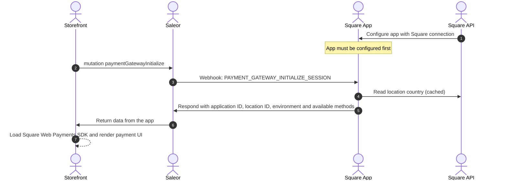
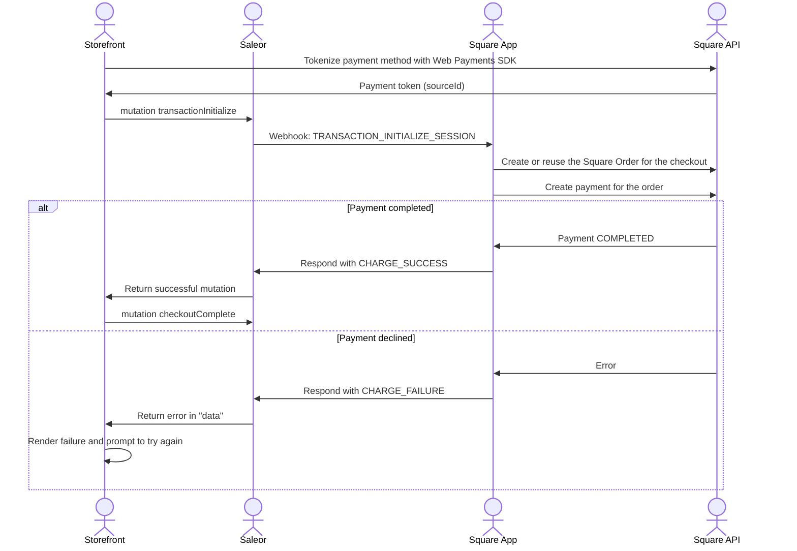
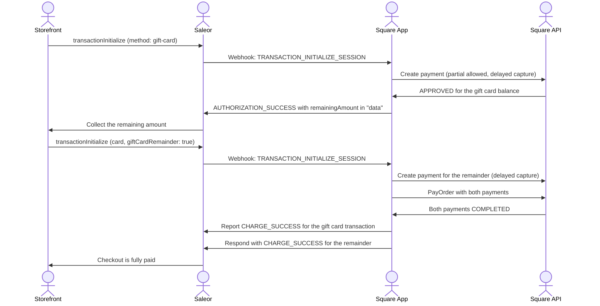
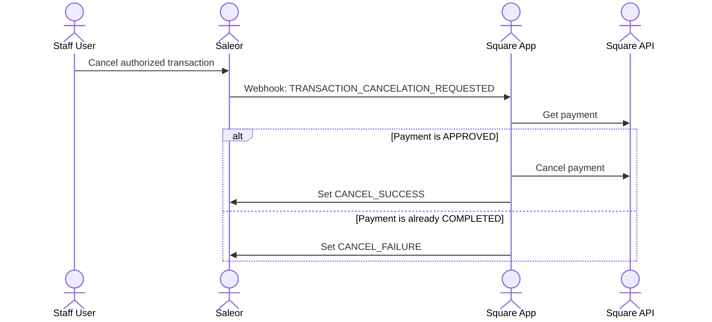
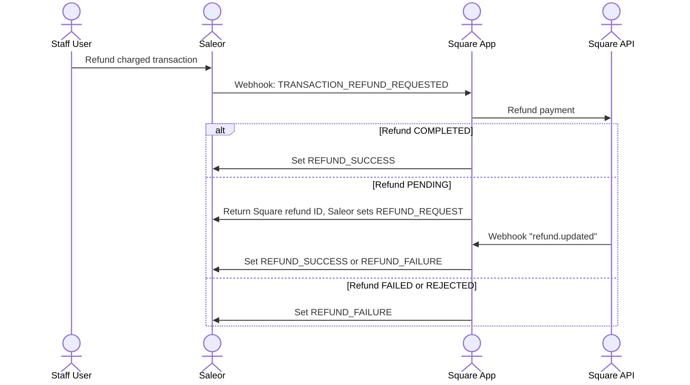
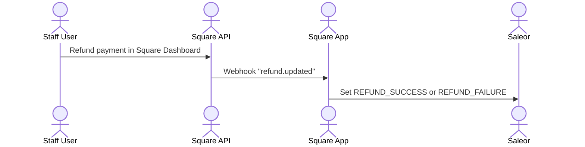
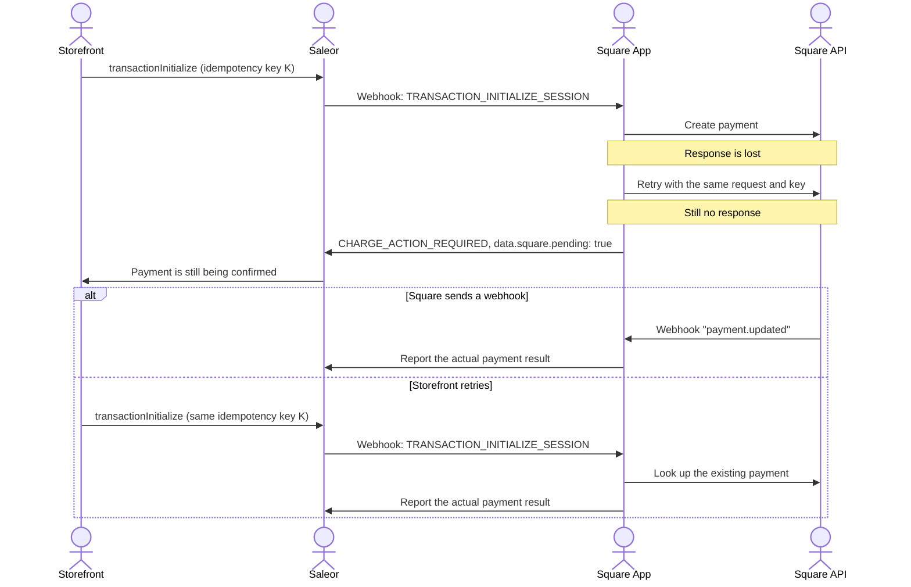

This page describes the assumptions the Square App is built on and the payment flows it supports between the storefront, Saleor, the app, and Square.

## Assumptions

These are decisions made by the Saleor product team. We may add more assumptions when we add more features, but the ones already set are final.

That means:

- You can rely on them when building your store, and they will not change.
- You should not use this app if you do not agree with them.
- If we change them, we will release a new major version.

### Charge flow only

The app charges payments immediately. It reports `CHARGE_SUCCESS` as soon as Square completes the payment.

The only exception is a [split payment with a Square gift card](#split-payments-with-a-square-gift-card). The gift card is authorized first and charged together with the rest of the payment.

The app rejects payments that Saleor initializes with the `AUTHORIZATION` action. Saleor takes the action from the channel's transaction flow, so make sure it's set to `CHARGE`.

### Saleor is the source of truth for amounts

The app never takes the amount, currency, line items, or checkout ID from the storefront. It reads them from the Saleor webhook payload. The storefront only sends the payment method and the token returned by the Square Web Payments SDK.

### One Square Order per checkout

Before the first payment, the app creates an itemized [Square Order](https://developer.squareup.com/docs/orders-api/what-it-does) from the checkout lines and shipping. It stores the Square Order ID in the checkout's private metadata under the `saleor.app.square:order:v1` key.

Every payment attempt for the same checkout is attached to the same Square Order. This keeps a single receipt history in Square, even when the customer retries a payment or pays with more than one method.

If the checkout changes between payment attempts, the app updates the Square Order to match it. Once the Square Order is completed or canceled, it can't take new payments.

### Idempotency

Saleor generates an idempotency key for each `transactionInitialize` call, or you can pass your own. The app derives the Square `CreatePayment` idempotency key from it. Retrying `transactionInitialize` with the same key never creates a second charge.

### Square event deduplication

Square may deliver the same webhook more than once. The app doesn't deduplicate events itself, Saleor does. When an event is reported a second time, Saleor marks it as already processed and the app handles it gracefully.

### PSP reference

The app sets the Square payment ID as the transaction `pspReference`, prefixed with an internal connection identifier (for example `sqref_v1:...`). Don't parse this value. Use `data.square.paymentId` returned by `transactionInitialize` if you need the raw Square payment ID.

The transaction `externalUrl` points to the Square receipt.

## Supported flows

This chapter lists the flows the app supports, including the storefront, Saleor, the app, and Square.

Flows that start in the Saleor Dashboard can also be executed with GraphQL.

For brevity, the diagrams highlight the most important parts of the flow and don't repeat operations that are not relevant to it.

### Render payment UI

### Payment with a card or wallet

Unlike Stripe, Square doesn't require a separate confirmation step on the storefront. The payment is charged during `transactionInitialize`, so you don't need to call `transactionProcess`.

### Split payments with a Square gift card

A customer can pay part of the total with a Square gift card and the rest with another method.

The gift card payment allows a partial amount and is only authorized. The remaining amount is paid with a separate Saleor transaction, attached to the same Square Order. Once all tenders cover the order total, the app settles them together with the Square [`PayOrder`](https://developer.squareup.com/reference/square/orders-api/pay-order) endpoint.

If the gift card covers the whole total, the app settles the order without a second payment.

Square cancels the gift card authorization automatically if the remainder isn't paid within 30 minutes. Closing the browser doesn't cancel it earlier.

### Cancelling a gift card authorization from Saleor Dashboard

Only authorized (not yet charged) gift card payments can be canceled. A charged payment must be refunded instead.

### Refunding funds from Saleor Dashboard

For a split payment, each Saleor transaction is refunded separately against its own Square payment.

### Refunding funds from Square

### Recovering an uncertain payment

A network timeout doesn't mean the payment failed. Square may have charged the customer even if the app never received the response.

Before calling Square, the app stores a record of the payment attempt. If the response is lost, the app retries once with the same idempotency key. If the outcome is still unknown, the app responds with `CHARGE_ACTION_REQUIRED` and `data.square.pending: true`.

:::warning[Don't start a new payment while a previous one is pending]
`CHARGE_ACTION_REQUIRED` doesn't mean the customer must pay again. Keep the original idempotency key and retry with it, or wait for the transaction to be updated. The app rejects new payments for the checkout while an earlier attempt is unresolved, but your storefront should not offer a new payment in this state either.
:::
