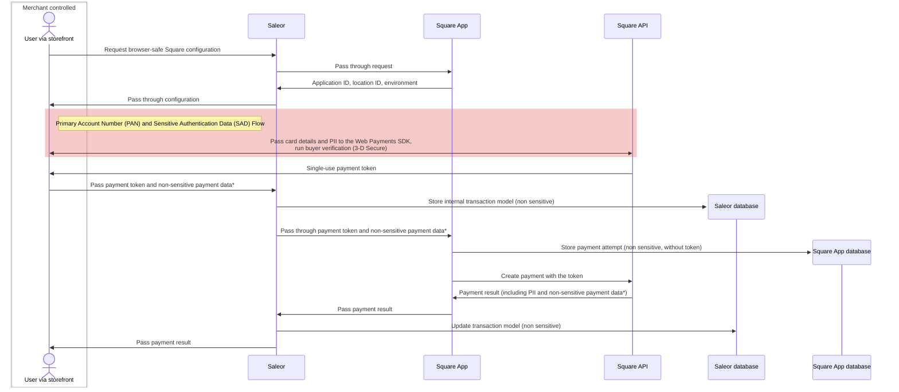

The following diagram shows the flow of sensitive data between services when using the Square App:

\*Passes non-PCI DSS regulated payment information, such as the payment method type, card brand, and last four digits.

Card numbers and security codes never reach the storefront's servers, Saleor, or the app.

For more information about Square PCI DSS compliance, see the [Square documentation](https://developer.squareup.com/docs/web-payments/overview#pci-compliance).
