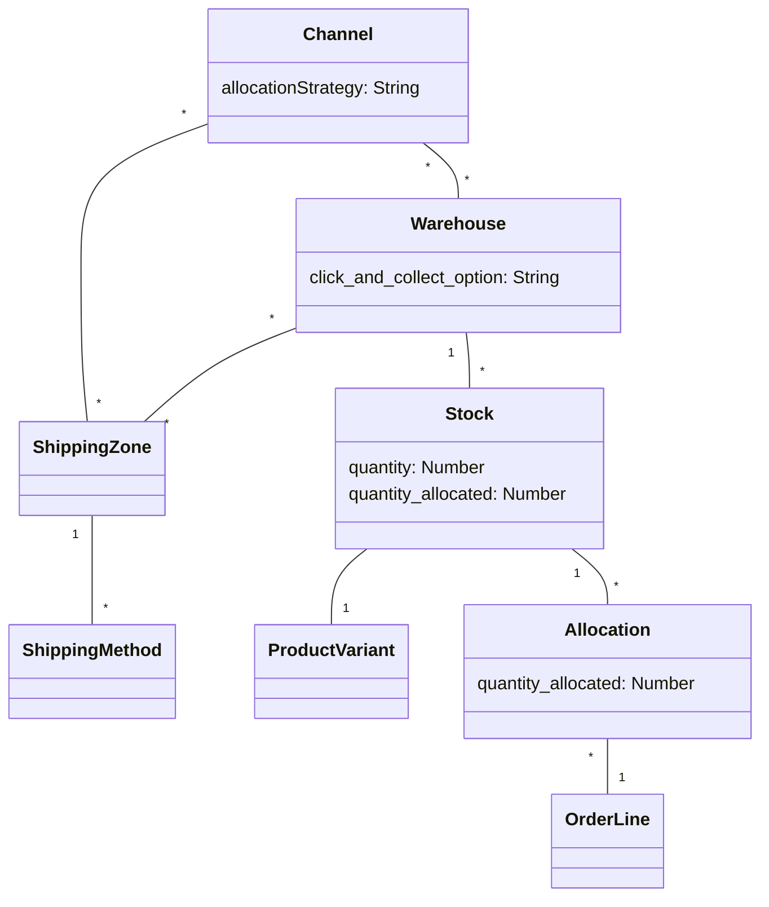
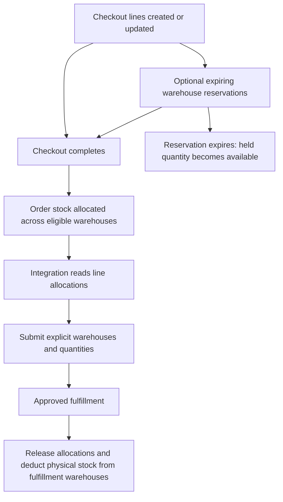

This guide explains how the allocations are handled in Saleor.

## Glossary

The warehouses and channels must be linked to provide the expected allocation. 
Below you can find the explanation of the terms that will be required to understand this guide properly:

- channel - allows configuring your shop differently for different currencies. See the [channel documentation](/developer/channels/overview) for details.
- shipping zone - allows for defining the cost of shipping in different areas of the world
  with the use of shipping methods
- warehouse - contains stocks of specific products, assigned to a given channel,
  can be defined as the collection point
- stock - corresponds to resources of specific product variant in the given warehouse
- allocation - corresponds to the currently allocated stocks for a given order line
- allocation strategy - defines the preferences of warehouses for stock allocation
  and reservations

The relations between the mentioned entities are shown in the chart below:

## Allocation flow

Stocks are allocated in the checkout completion process for all lines
with track inventory turned on. Each line is allocated according to the
[allocation strategy](#allocation-strategies) in the given channel.
Multiple allocations are created when there is insufficient available quantity in one stock.
Insufficient quantity in all product stocks raises the `InsufficientStock` error.

The line can be allocated only in the stocks that fulfill the following conditions:

- the stock's warehouse is available in the channel in which the order is created
- the stock has available quantities

:::info
When [`useLegacyShippingZoneStockAvailability`](/api-reference/miscellaneous/objects/shop#use-legacy-shipping-zone-stock-availability)

is enabled, an additional condition applies: the stock's warehouse must have a shipping zone 
that includes the shipping address (or billing address if the shipping address is not set) country code, 
and this shipping zone must be available in the channel in which the order is created. 
See [Legacy Stock Availability](/developer/stock/overview#legacy-stock-availability) for details.
:::

### Allocation strategies

The allocation strategies allow defining the rule that is used during the stock
allocation. At this moment, two possible options are available:

- Prioritize warehouses by sorting order (`PRIORITIZE_SORTING_ORDER`) - allocate stocks
  according to the warehouses' order within the channel. If stock is insufficient,
  the remaining quantity is allocated in the next warehouse on the list
  and repeated if necessary.
  To change the warehouses' order within the channel, use
  [`channelReorderWarehouses`](/api-reference/channels/mutations/channel-reorder-warehouses) mutation.
- Prioritize warehouses with the highest stock (`PRIORITIZE_HIGH_STOCK`) - allocate stock
  in a warehouse with the most stock. If not enough stock is available in a single
  warehouse, the remaining quantity is allocated in the next warehouse on the list
  and continues to the next one if necessary.
  In this scenario, the warehouses' order within the channel is ignored.

#### Allocation

In the case of the checkout with the local collection point, the stock allocation can be made
only from the current warehouse. Insufficient quantity raises the `InsufficientStock` error. In the case of the checkout with the global collection point, the stocks
are allocated from the chosen warehouse first. If there is insufficient quantity,
the stocks are allocated from the next warehouse with the highest available quantity value.

## From checkout to fulfillment

For inventory-tracked products, reservations and allocations hold quantities in specific warehouses without decreasing physical stock (`Stock.quantity`). A line can have holds in more than one warehouse.

1. Creating a checkout with lines, or adding/updating its lines, creates expiring [reservations](/developer/stock/stock-reservation) when enabled for that customer type.
2. Completing checkout creates order allocations using the channel's allocation strategy. Saleor selects warehouses again; it does not guarantee that the order allocation uses the checkout reservation's warehouses.
3. Your integration reads `OrderLine.allocations` to obtain warehouse IDs and allocated quantities.
4. Your integration submits `orderFulfill` with explicit warehouse IDs and quantities. It can follow the allocations or select another eligible warehouse with sufficient stock.
5. Approved fulfillment releases the fulfilled quantity from the line's allocations and decreases physical stock in the fulfillment warehouse. When approval is required, these stock changes wait for approval.

See [warehouse selection for fulfillment](/developer/order/order-fulfillment#warehouse-selection-for-fulfillment) for an API query and an example of fulfilling from a different warehouse. See [releasing stock for an unfulfilled line](/developer/order/order-fulfillment#releasing-stock-for-an-unfulfilled-line) for partial cancellation and return behavior.
