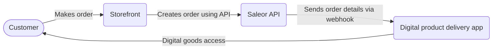

Learn how to set up and manage digital products (like software, e-books, or services) in Saleor with this guide. Since these items don't require shipping, the focus is on configuring specific product types and setting up automated asset delivery after purchase.

## Create Product Type for Digital Goods

:::tip[Configuration template]

Use [Saleor Configurator](/developer/tools/configurator#start-from-a-recipe) with the [`digital-products` template](https://github.com/saleor/configurator/blob/main/recipes/README.md#digital-products-digital-products) to create product types without shipping requirements. Follow the rest of this guide to implement asset delivery and storefront behavior.

:::

A Product Type acts as a template for creating products. It defines the structure, including whether items require shipping and what attributes they have.

Set up a new Product Type. Make sure to disable the "Requires Shipping" setting for this type, so the shipping step is skipped during checkout if the cart only contains these digital products.

<CardGroup>
  <Card title="Product Types" href="/developer/products/overview" arrow>

Read more about structuring and organizing product data.

</Card>
  <Card title="Product Configuration" href="/developer/products/configuration" arrow>

Learn how to configure products.

</Card>
</CardGroup>

## Create Your Products

Create products using your new product type. Fill in the product details, such as name, description, category and add variants.

For each variant, you need to create stock entries. Products without stock won't be available for purchase. If your product has unlimited stock, disable the "track inventory" setting.

<CardGroup>
  <Card title="Stock Tracking" href="/developer/stock/stock-tracking" arrow>

Learn how to track inventory in Saleor.

</Card>
</CardGroup>

## Make Changes in Your Storefront

Your storefront needs to adapt its checkout flow based on whether shipping is required.

When a cart contains _only_ digital products (where `isShippingRequired` is false), the checkout process should skip shipping address collection and shipping method selection.

<CardGroup>
  <Card title="Storefront Quickstart" href="/quickstart/storefront" arrow>

Get started with the NextJS example storefront.

</Card>
  <Card title="Checkout Shipping" href="/developer/checkout/address" arrow>

Learn about shipping and checkout APIs.

</Card>
</CardGroup>

## Asset Delivery

When an order is paid, you need to make the digital content accessible to the customer. Use webhooks to integrate with your business backend.

Create a webhook in the dashboard. Choose `Order fully paid` event, define the subscription query, and target URL. When an order is paid, Saleor will send data defined by subscription query to the provided address. Now recipient application will be able to perform necessary operations like updating subscription details or sending an email with a download link.

<CardGroup>
  <Card title="Apps Overview" href="/developer/extending/apps/overview" arrow>

Learn how to build Saleor Apps.

</Card>
  <Card title="Webhook Payloads" href="/developer/extending/webhooks/subscription-webhook-payloads" arrow>

Learn how to create custom event subscriptions.

</Card>
</CardGroup>
